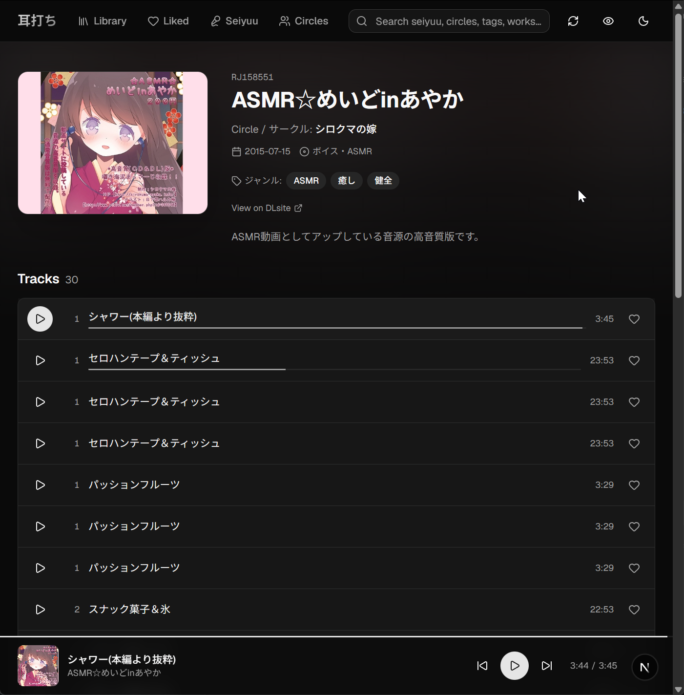
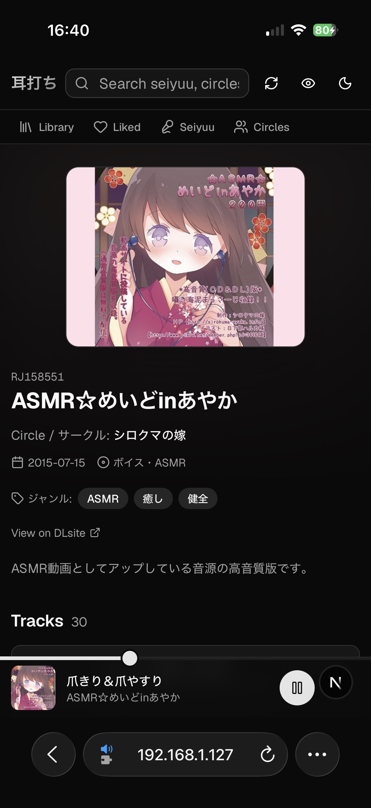

# mimiuchi

A personal audio library web app for browsing and playing locally-stored audio works. Point it at a folder of RJ-coded releases and it builds a searchable, taggable library with covers, metadata, and a player that follows you around the app.

<p align="center">
  
  
</p>

## Features

**Library**

- Scans one or more local folders of RJ-coded works and pulls titles, cover art, circle, voice actors, and tags automatically
- Works still packed in a `.zip`, `.rar`, or `.7z` are listed too, with their full metadata and a red tint to mark that there is nothing to play yet — extract the archive and re-scan and the entry becomes the real thing, no duplicate left behind
- Browse by work, by voice actor, or by circle
- Filter by tag, voice actor, and circle, with sorting
- Fuzzy Japanese search with autocomplete — type romaji, kana, or kanji and it finds the match
- Edit a work's cover, voice actors, and metadata by hand; add your own tags; delete an entry
- Reveal a work's folder in your file manager
- Blur R18 covers with one click, and a light/dark theme toggle

**Extras**

- Picks up the non-audio files that ship with a work — bonus illustrations, おまけ videos, and 台本 (scripts) — and puts them in a collapsed panel on the work page, so they never crowd out the tracks
- Scripts are told apart from readmes, which are always ignored; a 台本 is recognised even when only the folder it sits in says so
- Reads a `.txt` 台本 in the app as continuous vertical Japanese, with a horizontal toggle and adjustable text size. PDF scripts open in a new tab
- When a work ships one 台本 per track, each track row gets its own link to it
- Illustrations open in a gallery; videos play in place, seekable however large they are

**Playback**

- Persistent player bar that keeps playing as you navigate
- Queue, plus media-session support so lock-screen and headset controls work
- Remembers your position in every track and picks up where you left off
- Choose between a classic progress bar or a waveform seek bar that shows loudness so you can see pauses and peaks before scrubbing (generated once per track and cached)
- Per-track bookmarks, stored server-side so they follow you between devices
- Like tracks and browse everything you've liked in one view
- "On deck" row of recently added works, with a shuffle for when you can't decide

**Setup & admin**

- Trigger a library scan from inside the app with live progress, including an
  extras-only pass that re-reads files without contacting DLsite
- Delete a work's folder and the next scan hides it from the library, keeping
  the entry — and its likes and playback progress — until you confirm removal
  in Settings. A library root that can't be read is never mistaken for one that
  was emptied, so an unplugged drive changes nothing
- A track whose file has gone says so and the queue moves on, instead of the
  player stalling on it
- First-run setup in the browser: pick your library folders (with a folder
  browser that shows how many works it sees) and choose a password. No config
  files to edit
- Single shared password login, changeable in Settings (which signs other
  devices out)
- Configure library roots, cover directory, and an optional outbound proxy from the settings page
- A portable Windows build: unzip, double-click `mimiuchi.exe`, no Node.js needed

## Three ways to run it

| | For | Needs |
| --- | --- | --- |
| [Windows portable zip](#windows-portable-zip) | Anyone on Windows | Nothing. Unzip and double-click |
| [Docker](#docker) | A home server / NAS | Docker |
| [From source](#setup) | Development, or Linux/macOS without Docker | Node.js 22.19+ and pnpm |

All three ask for your library folder and a password in the browser on first
visit.

## Windows portable zip

**Using it.** Download `mimiuchi-<version>-windows-x64.zip`, extract it (right-click →
**Extract All…**), and double-click `mimiuchi.exe`. A console window opens and shows
the addresses to use on this computer and on your phone, and your browser opens
the setup page. The window is the on/off switch: close it to stop the server.
The `README.txt` inside the zip walks a non-technical user through all of this,
including the SmartScreen and firewall prompts, in English and Japanese.

Because the zip is unsigned, Windows SmartScreen shows "Windows protected your
PC" the first time; **More info → Run anyway** gets past it.

**Where things live.** The app folder holds no personal data. The database,
cover art, caches, password hash and log go to `%LOCALAPPDATA%\mimiuchi` (override
with the `MIMIUCHI_HOME` environment variable), so upgrading is "delete the old
folder, extract the new one". Optional `ffmpeg\ffmpeg.exe` next to `mimiuchi.exe`
enables the waveform seek bar and WAV transcoding.

**Launcher behaviour.** Port 3000 by default (`--port`, or `PORT`). If mimiuchi is
already running there, a second double-click just opens the browser. If another
program has the port, it takes the next free one and says so. Server output goes
to `%LOCALAPPDATA%\mimiuchi\logs\server.log`; only errors appear in the window, so
the phone address stays on screen.

**Building it** (on Windows, from the repo root):

```powershell
pnpm -C web package:windows
# or, bundling an ffmpeg build you are allowed to redistribute:
pwsh packaging\windows\build.ps1 -FfmpegExe C:\path\to\ffmpeg.exe
```

**Releasing.** `.github/workflows/release-windows.yml` runs the same script on
GitHub. Set `version` in `web/package.json`, commit, then
`git tag v<version>; git push origin v<version>`. The workflow builds the zip and
publishes a GitHub Release with it attached; it refuses a tag that doesn't
match `package.json`. Running the workflow by hand (Actions → Windows release →
Run workflow, or `gh workflow run release-windows.yml`) builds without
releasing and leaves the zip under the run's Artifacts.

The output is `dist\windows\mimiuchi-<version>-windows-x64.zip` plus a `.sha256`. The
script downloads the latest Node.js 22 for win-x64 (checksum verified, cached),
builds from a clean copy of `web\` in `dist\windows\work`, and never touches your
`web\.next`, `node_modules`, or data. The build needs network access, for the
Node download and for `next/font`. See the header of
`packaging/windows/build.ps1` for the details: flat `node_modules`, since a zip
cannot hold pnpm's links; the SWC compiler dropped by shipping a transpiled
`next.config.js`; and a smoke test of the native modules under the bundled
`node.exe`.

## Prerequisites (from source)

- Node.js 22.19+ (undici needs it) and [pnpm](https://pnpm.io/installation) — or Docker, see [Docker](#docker) below.
  If pnpm manages your Node (`pnpm config get use-node-version` prints a version),
  that is the one that runs the app: `pnpm env use --global 22` updates it
- A directory of audio works named by DLsite RJ code (e.g. `RJ01000380/...`), or archives named the same way (e.g. `【RJ01000380】【MP3】.zip`)
- `ffmpeg` on your `PATH` — optional, only needed for the waveform seek bar (or point `KIKOERU_FFMPEG_PATH` at the binary)

## Setup

```bash
git clone https://github.com/4890A/mimiuchi.git
cd mimiuchi/web
pnpm install
```

That's all the configuration needed: on first visit the app asks for your
library folder(s) and a password. To manage either from the environment instead
(for a headless box, say), `cp .env.example .env.local` and set the variables below.

### Environment variables

`KIKOERU_LIBRARY_ROOT` and `KIKOERU_COVERS_DIR` are fallbacks: once **Settings →
Library paths** has a value, that value wins and the env var is ignored. The Settings
page shows the env value as the placeholder so you can see which one is in
effect. Leave the Settings fields blank to keep using the env vars.

| Variable | Required | Description |
| --- | --- | --- |
| `KIKOERU_LIBRARY_ROOT` | no | Absolute path to the folder containing your RJ-coded work directories. Usually set on the setup page instead |
| `KIKOERU_PASSWORD` | no | Shared login password. When set it always wins and the in-app password form is hidden. Unset, you choose one on the setup page; it is stored as a scrypt hash in `<KIKOERU_DATA_DIR>/password`, and deleting that file resets it (the setup page comes back, library intact). There is no default password any more |
| `KIKOERU_SESSION_SECRET` | no | Overrides the session-cookie signing key. If unset, a random 32-byte secret is generated on first run and stored in `<KIKOERU_DATA_DIR>/session-secret` |
| `KIKOERU_DATA_DIR` | no | Where the SQLite database lives (defaults to `../data` relative to `web/`) |
| `KIKOERU_COVERS_DIR` | no | Where cover art is cached (defaults to `<project-root>/covers`) |
| `KIKOERU_FFMPEG_PATH` | no | Path to the `ffmpeg` binary if it isn't on your `PATH` |
| `KIKOERU_THUMBNAIL_CACHE_MB` | no | Ceiling for the gallery thumbnail cache in `<KIKOERU_DATA_DIR>/thumbnails` (default 512, `0` for no limit) |
| `KIKOERU_TRANSCODE_CACHE_MB` | no | Ceiling for the transcoded-audio cache in `<KIKOERU_DATA_DIR>/transcodes` (default 4096, `0` for no limit) |
| `KIKOERU_SECURE_COOKIES` | no | Forces the login cookie's Secure flag (`true`/`false`). Unset, it follows each request: Secure over HTTPS (including behind a reverse proxy that sends `X-Forwarded-Proto: https`), not Secure over plain `http://<ip>`. Set `true` only if your HTTPS proxy doesn't send that header |

## Running

All commands run from the `web/` directory.

### Normal use

Build once, then start the server. This is the mode to use day to day: an
optimized build, without the dev server's hot reloading, source maps, and
verbose console output.

```bash
pnpm build          # compile the app
pnpm start          # serve it on http://localhost:3000
```

The server runs in the foreground until you stop it with `Ctrl-C`. It serves
whatever `pnpm build` last produced, so re-run `pnpm build` after pulling or
editing code — a running server won't pick the changes up on its own.

To use a different port, pass `-p` (or set `PORT`):

```bash
pnpm start -p 3001
```

`pnpm start` listens on `0.0.0.0`, so the app is reachable from phones and
other machines on your network at `http://<your-machine-ip>:3000` without any
extra configuration. Nothing here starts on boot by itself — wrap `pnpm start`
in whatever your OS uses to keep services alive (a systemd unit, a Windows
scheduled task, pm2) if you want it always available.

### Development

```bash
pnpm dev            # dev server with hot reloading, on http://localhost:3000
```

Use this only while working on the code — it recompiles on every change and
logs far more, which makes it noticeably slower to browse.

> Hitting the **dev** server from another device also needs that device's IP in
> `allowedDevOrigins` in `web/next.config.ts`. Without it Next.js blocks the
> page's JavaScript from taking over, and the app renders but every button is
> dead. `pnpm start` has no such restriction.

The database is created and migrated automatically on first connection — a
fresh checkout provisions an empty database on startup, so there's no manual
migration step. (Existing databases from before automatic migrations are
detected and left untouched.)

On first visit you land on the setup page: pick your library folder(s) and a
password (or, with `KIKOERU_PASSWORD` set, just log in). The first scan then starts
by itself. It walks your library folders, fetches metadata, and streams
progress to a panel in the bottom-right. Re-run it from the **Scan** button
whenever you add new works.

> **Upgrading an install that never set `KIKOERU_PASSWORD`?** It used to fall
> back to `changeme`. That default is gone: such an install now shows the setup
> page once, so you can choose a real password. Installs that set the variable
> are unaffected.

> Upgrading from a version without the extras panel? Just scan once. The first
> scan after the upgrade re-walks every work to index its non-audio files, then
> goes back to skipping unchanged ones. It reads local directories only — no
> metadata is fetched — so it costs seconds and nothing else.

Later on, if you drop new files into a work you have already scanned, use
**Re-scan extras only** in Settings. An ordinary scan skips a work whose folder
hasn't changed, and that check looks at the work folder itself — which adding
`おまけ/台本.txt` does not touch, since only the immediate parent directory's
timestamp changes. The extras scan re-reads every work's files and never
contacts DLsite, so it is the cheap way to pick those up; a full force rescan
would find them too, but only by re-fetching every listing.

> A `pnpm scan` CLI script also exists (`web/scripts/scan.ts`) if you'd rather run the scan headlessly.

### Docker

An alternative to installing Node and pnpm. Nothing here changes how the
node/pnpm setup above works; the two are independent.

```bash
git clone https://github.com/4890A/mimiuchi.git
cd mimiuchi
cp .env.docker.example .env      # then set MIMIUCHI_LIBRARY
docker compose up -d --build
```

Open `http://<host-ip>:3000` and choose a password; `/library` is already filled
in, and the first scan starts on its own. The image bundles
`ffmpeg`, so the waveform seek bar and transcoding work out of the box. The
root `.env` file is read only by Docker Compose; it does not interact with
`web/.env.local`.

**Where things live.** Your library is bind-mounted read-only at `/library`
(the app never writes into it). Everything the app writes goes to two Docker
volumes: `data` (the SQLite database, session secret, thumbnail and transcode
caches) and `covers` (downloaded cover art). Both survive `docker compose down`
and image rebuilds. Named volumes are used rather than bind mounts because
SQLite's write-ahead log needs file locking that Docker Desktop's file sharing
does not reliably provide; on a Linux host you can swap `data:/data` for a host
path in `compose.yaml` if you prefer.

**Multiple library folders.** Add more bind mounts under `/library` in
`compose.yaml`, e.g. `/mnt/a:/library/a:ro` and `/mnt/b:/library/b:ro`, then
either set `KIKOERU_LIBRARY_ROOT=/library/a:/library/b` under `environment:`
(`:` is the separator inside the container) or list them one per line in
**Settings → Library paths**.

**Permissions.** The container runs as the unprivileged `node` user (uid 1000).
If your library is not world-readable, add `user: "<uid>:<gid>"` to the service
so it runs as the owner of those files.

**HTTPS and cookies.** The login cookie is marked Secure only when the request
came over HTTPS, so login works over plain HTTP on your LAN as-is. Behind an
HTTPS reverse proxy that sends `X-Forwarded-Proto` (Caddy, Traefik and nginx's
usual config all do), nothing needs setting. If yours doesn't, set
`KIKOERU_SECURE_COOKIES=true` in `.env`.

**DLsite proxy.** Inside the container `localhost` is the container itself. A
proxy running on the host machine is reachable as
`http://host.docker.internal:<port>` in **Settings → DLsite → Proxy URL**.

**Open folder.** The "Open folder" button on a work page is hidden in Docker,
since there is no desktop for the container to hand the path to.

**Upgrading.** `git pull && docker compose up -d --build`. Database migrations
run on the first request after start. `docker compose logs -f app` shows the
server log and `docker compose ps` reports the health check.

### Moving an existing install into Docker

Works are stored with the absolute path they were found at, so a database
from a node/pnpm install still points at the old locations. Backup import
re-homes every work by its RJ code under the current library roots, so:

1. On the old install, **Settings → Backup → Download backup**.
2. Start the container against the same library folder and log in.
3. **Settings → Restore from backup → Choose file** and import it.
4. Open **Settings → Library paths**. The restored settings still carry the old host's
   library and cover paths (e.g. `D:\Audio\works`), and a value there overrides
   the container's env vars. Clear both fields (blank means `/library` and
   `/covers`), save, then run a **Scan**.

Alternatively skip the backup and scan from scratch; you lose likes, play
progress, bookmarks and manual edits. Non-DLsite works (`LOCAL-…` ids) are
identified by a hash of their old path and cannot be re-homed, so they will
be re-created as new works either way.

### Other scripts

- `pnpm lint` — ESLint
- `pnpm db:studio` — open a browser UI against the database
- `pnpm db:generate` — after editing `schema.ts`, generate a migration into `web/drizzle/` and commit it; it's applied automatically on the next start
- `pnpm db:push` — push the schema to the db directly without a migration (handy for quick local iteration)

## Project layout

```
.
├── web/              App source, scripts, configs
├── data/             Database  (gitignored)
├── covers/           Cached cover art (gitignored)
├── packaging/windows Portable Windows build (launcher, build script, user README)
├── Dockerfile        Optional container image (see Docker above)
├── compose.yaml      Optional Docker Compose deployment
└── .env.docker.example   Template for the compose `.env`
```
